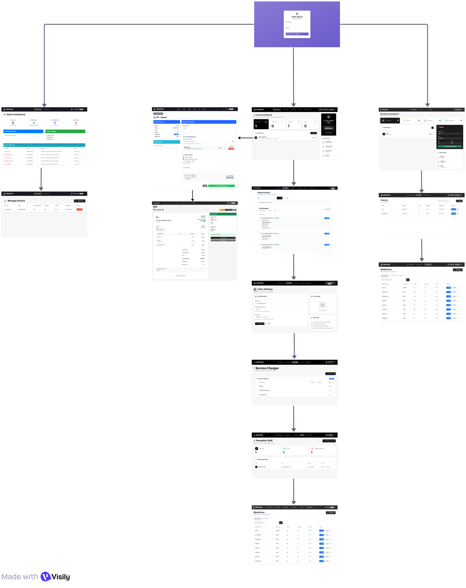
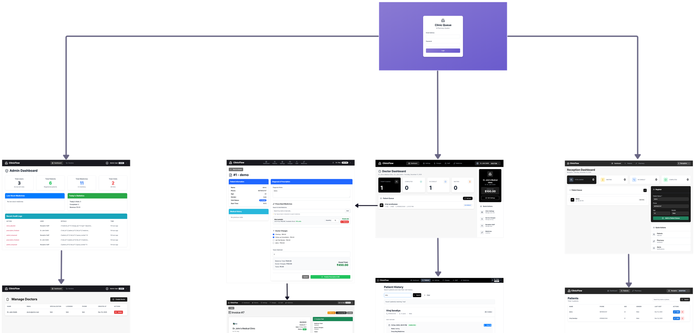
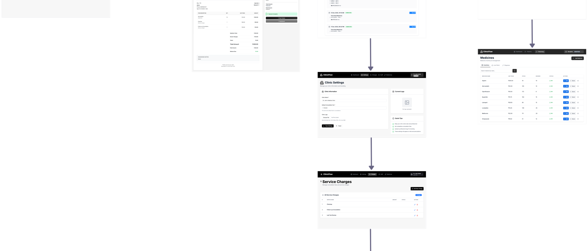
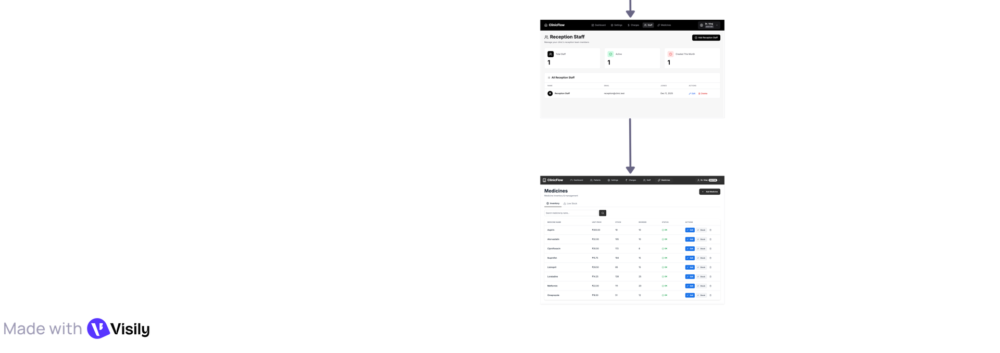
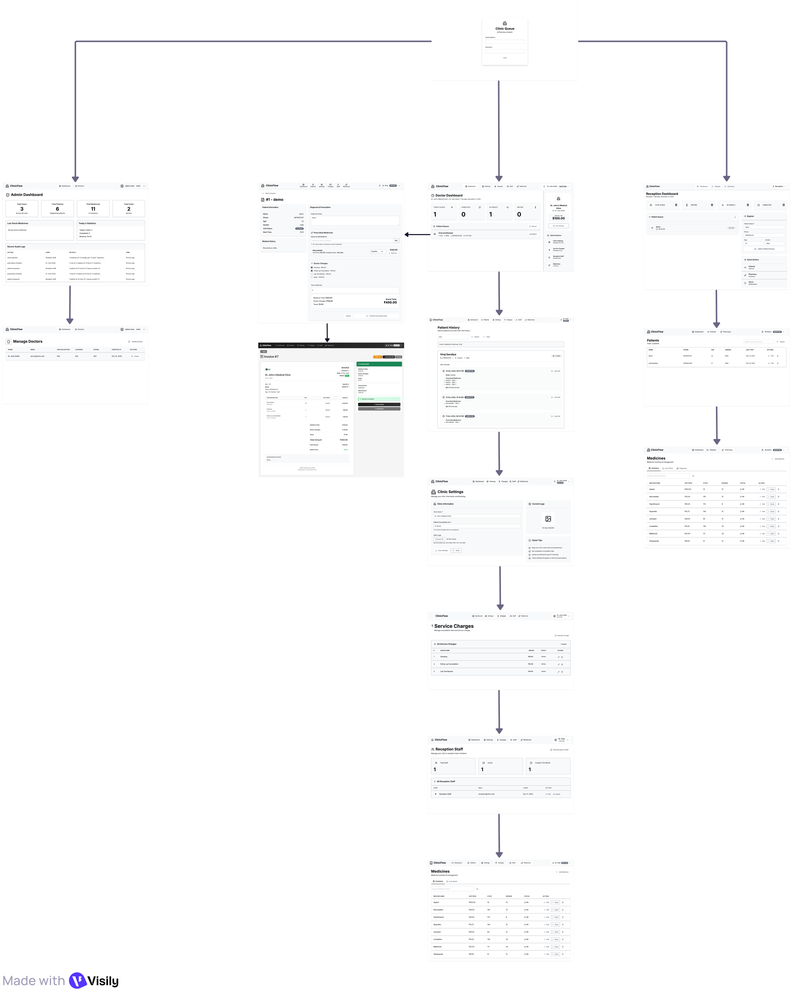

<div align="center">

# 🏥 ClinicFlow
### Modern Healthcare Practice & Pharmacy Queue Management System

[](https://laravel.com)
[](https://php.net)
[](https://mysql.com)
[](https://docker.com)
[](./LICENSE)

<br/>

**ClinicFlow** is an enterprise-grade medical clinic management platform engineered to automate clinical operations, streamline patient queueing, accelerate doctor consultations, and provide real-time pharmacy inventory control.

[Key Features](#-key-features) • [Screenshots & UI Showcase](#-screenshots--ui-showcase) • [System Architecture](#-system-architecture) • [Getting Started](#-getting-started) • [Docker Deployment](#-docker-deployment) • [Default Credentials](#-default-demo-credentials) • [License](#-license)

</div>

---

## 📸 Screenshots & UI Showcase

### Comprehensive System Architecture & Workflow UI
> Full wireframe and user journey design covering patient check-in, clinical consultation, e-prescription generation, and pharmacy dispensing.



---

### Multi-Module Previews

<div align="center">

| 🩺 Doctor Portal & Live Queue | 📋 Clinical Records & Visit Notes |
|:---:|:---:|
|  |  |
| *Real-time queue triage, active consultation, and patient history* | *Diagnosis recording, e-prescriptions, and printable bills* |

| 💊 Pharmacy & Inventory Control | 📐 Blueprint & Wireframe Specification |
|:---:|:---:|
|  |  |
| *Stock level thresholds, medicine dispensing, and automated deductions* | *Low-fidelity architectural blueprint and user journey layouts* |

</div>

---

## ✨ Key Features

### 👨‍⚕️ 1. Doctor Consultation Suite
- **Interactive Patient Queue**: Live queue triage with one-click status transitions (*Waiting*, *In Consultation*, *Completed*).
- **Comprehensive Patient History**: Instant access to chronological visit records, past diagnoses, and treatment timelines.
- **E-Prescription Builder**: Fast medication lookup, dosage specifications, intake frequency instructions, and notes.
- **Prescription PDF Generation & Verification**: High-definition printable PDF prescriptions with cryptographic QR verification links (`/prescription/verify/{id}`).
- **Practice Settings & Service Tariffs**: Configure clinic branding, consultation fees, and procedural charges.
- **Doctor Schedule & Holiday Planner**: Slot-based schedule management, custom consultation hours, and holiday blackout dates.

### 👩‍💼 2. Reception & Front-Desk Operations
- **Smart Patient Triage**: Quick search by phone number or national identity; new patient onboarding in seconds.
- **Queue Orchestration**: Real-time token issuance and automated queue positioning.
- **Appointment Scheduling & Calendar**: Visual calendar interface, available slot calculation, and seamless rescheduling.
- **Automated Patient Notifications**: Reminder management for appointment follow-ups and clinic notices.

### 💊 3. Pharmacy & Medicine Inventory
- **Real-Time Stock Tracking**: Automated deduction upon dispensing; real-time visibility into quantities on hand.
- **Low-Stock Alerts**: Proactive notifications when inventories cross reorder thresholds.
- **Stock Movement Ledger**: Full audit trail for manual adjustments, incoming batches, and dispensing deductions.
- **Fast Medicine Dispensing**: Typeahead search with instant stock verification to prevent dispensing unavailable inventory.

### 🧾 4. Billing, Invoicing & Financial Records
- **Itemized Patient Invoicing**: Dynamic billing combining doctor consultation charges and dispensed medication costs.
- **PDF Invoice Generation**: Professional, print-ready invoices built with Barryvdh DomPDF.
- **Payment Reconciliation**: Record payment modes (Cash, Card, Digital) and maintain outstanding balances.

### 🛡️ 5. Administrative Control & Security
- **Role-Based Access Control (RBAC)**: Distinct permissions for `admin`, `doctor`, and `reception`.
- **Doctor & Staff Onboarding**: Admins manage doctor profiles, credentials, and practice roles.
- **Enterprise Security**: CSRF protection on state-changing requests, parameterized queries via Eloquent ORM, rate limiting on authentication routes (`throttle:5,1`), and strict input validation.

---

## 🏗️ System Architecture

ClinicFlow follows the **Laravel Model-View-Controller (MVC)** architectural standard, supplemented by modular service controllers and real-time frontend handlers:

```
┌─────────────────────────────────────────────────────────────┐
│                 Client Layer (Browser / Mobile)             │
│            Blade Templates + Axios + Custom CSS Grid        │
└──────────────────────────────┬──────────────────────────────┘
                               │ HTTP / HTTPS
                               ▼
┌─────────────────────────────────────────────────────────────┐
│                      Web Server Layer                       │
│                   Nginx / Apache (MAMP)                     │
└──────────────────────────────┬──────────────────────────────┘
                               │ FastCGI
                               ▼
┌─────────────────────────────────────────────────────────────┐
│                 Laravel 10 Application Kernel               │
│  ├── Middleware (Auth, Role Verification, Rate Limiting)    │
│  ├── Routes (routes/web.php & routes/api.php)               │
│  ├── Controllers (Reception, Doctor, Bill, Prescription)   │
│  └── Services (DomPDF Generator, QR Verifier)               │
└──────────────────────────────┬──────────────────────────────┘
                               │ Eloquent ORM
                               ▼
┌─────────────────────────────────────────────────────────────┐
│                      Database Layer                         │
│                    MySQL 8.0 / MariaDB                      │
│      (Patients, Visits, Appointments, Medicines, Stocks)    │
└─────────────────────────────────────────────────────────────┘
```

---

## 🛠️ Technology Stack

| Domain | Technology | Description |
|:---|:---|:---|
| **Backend Core** | PHP 8.1+ | Strongly typed server runtime |
| **Framework** | Laravel 10.x | Modern PHP web application framework |
| **Database** | MySQL 8.0 / MariaDB | Relational data persistence with relational integrity |
| **PDF Engine** | Barryvdh Laravel DomPDF | Server-side invoice & prescription generation |
| **Frontend UI** | Blade + Vanilla CSS + ES6 | Responsive layouts, CSS grid, modal dialogs |
| **HTTP Client** | Axios | Asynchronous API interactions |
| **Containerization** | Docker & Docker Compose | Multi-container environment (PHP-FPM, Nginx, MySQL) |
| **Tooling** | Make, Composer, Artisan | Build automation and dependency management |

---

## 🚀 Getting Started

### Prerequisites
- **PHP** >= 8.1
- **Composer** (PHP Package Manager)
- **MySQL** or **MariaDB**
- **Git**

### Installation

1. **Clone the repository:**
   ```bash
   git clone https://github.com/virajsavaliya/clinicflow.git
   cd clinicflow
   ```

2. **Install PHP dependencies:**
   ```bash
   composer install
   ```

3. **Configure Environment Variables:**
   ```bash
   cp .env.example .env
   php artisan key:generate
   ```

4. **Configure Database Connection in `.env`:**
   ```env
   DB_CONNECTION=mysql
   DB_HOST=127.0.0.1
   DB_PORT=3306
   DB_DATABASE=clinicflow
   DB_USERNAME=root
   DB_PASSWORD=your_mysql_password
   ```

5. **Run Migrations & Seeders:**
   ```bash
   php artisan migrate
   php artisan db:seed
   ```
   *(Optional)* Run developer setup scripts if configuring demo accounts:
   ```bash
   php create-admin.php
   php create-doctor-profile.php
   php update-medicines.php
   ```

6. **Create Storage Symlink:**
   ```bash
   php artisan storage:link
   ```

7. **Start Development Server:**
   ```bash
   php artisan serve
   ```
   The application will be live at `http://localhost:8000`.

---

## 🐳 Docker Deployment

ClinicFlow includes production-ready Docker configurations for turnkey containerized deployment:

```bash
# 1. Build and boot all containers in detached mode
docker-compose up -d --build

# 2. Run database migrations within the container
docker-compose exec app php artisan migrate --force

# 3. Seed demo data
docker-compose exec app php artisan db:seed

# 4. Generate app key
docker-compose exec app php artisan key:generate
```

| Service | Port | Description |
|:---|:---|:---|
| **Web Server** | `http://localhost:8080` (or `80`) | Nginx proxy serving Laravel public directory |
| **Database** | `localhost:3306` | MySQL container |
| **Redis** | `localhost:6379` | Cache and session store |

---

## 🔑 Default Demo Credentials

> ⚠️ *Change these default passwords immediately when deploying to a production environment.*

| Role | Email | Password | Access Portal |
|:---|:---|:---|:---|
| **Administrator** | `admin@clinic.com` | `admin@clinic.com` | `/admin/dashboard` |
| **Doctor** | `doctor@clinic.com` | `doctor123` | `/doctor/dashboard` |
| **Receptionist** | `reception@clinic.com` | `reception123` | `/reception/dashboard` |

---

## 📁 Repository Structure

```
clinicflow/
├── app/
│   ├── Http/
│   │   ├── Controllers/       # Reception, Doctor, Bill, Appointment controllers
│   │   └── Middleware/        # RBAC role verification, route guards
│   ├── Models/                # Patient, Visit, Appointment, Medicine, Stock models
│   └── Providers/             # Core service providers
├── config/                    # Application and third-party configurations
├── database/
│   ├── factories/             # Model factories for testing
│   ├── migrations/            # Relational database schema migrations
│   └── seeders/               # Initial system seeders
├── docs/
│   └── screenshots/           # High-resolution architectural screenshots
├── public/                    # Assets, entry point (index.php), brand images
├── resources/
│   └── views/                 # Blade UI templates (Auth, Doctor, Reception, Admin)
├── routes/
│   ├── web.php                # Authenticated application web routes
│   └── api.php                # RESTful JSON API endpoints
├── storage/                   # Logs, framework cache, and generated PDFs
├── docker-compose.yml         # Container orchestration manifest
├── Dockerfile                 # PHP 8.x + FPM container definition
├── Makefile                   # Quick-access CLI shortcuts
├── LICENSE                    # MIT Open-Source License
└── composer.json              # PHP dependencies and autoload rules
```

---

## 🔌 API Summary

ClinicFlow provides clean REST endpoints for frontend asynchronous updates:

```http
# Medicine Inventory Endpoints
GET    /api/medicines                 # Fetch paginated medicine inventory
POST   /api/medicines                 # Add new medication to catalog
PUT    /api/medicines/{id}            # Modify medication details
DELETE /api/medicines/{id}            # Soft/hard remove medication
POST   /api/medicines/adjust-stock    # Adjust stock levels with audit log

# Inventory Alerts
GET    /doctor/api/inventory-alerts   # Fetch active low-stock alerts
POST   /doctor/inventory-alerts/mark-ordered/{medicine} # Mark restock order placed

# Public Prescription Verification
GET    /prescription/verify/{id}      # Authenticate prescription validity via QR code
```

---

## 🔒 Security Best Practices

- **Strict Role Isolation**: Route middleware enforces strict separation of responsibilities (`role:admin`, `role:doctor`, `role:reception`).
- **Protected Environment Variables**: All secrets, DB credentials, and APP_KEY reside strictly in `.env` (excluded by `.gitignore`).
- **CSRF Token Validation**: Every POST, PUT, and DELETE request enforces CSRF token matching.
- **SQL Injection Prevention**: Eloquent ORM parameterized queries are used throughout all database interactions.
- **Rate-Limiting Protection**: Authentication endpoints are rate-limited (`5 attempts/min`) to safeguard against brute-force attacks.

---

## 📄 License

This project is licensed under the **MIT License** — see the [LICENSE](LICENSE) file for complete details.

---

## 👨‍💻 Author & Contributions

Developed by **[Viraj Savaliya](https://github.com/virajsavaliya)**.  
Contributions, feature suggestions, and issues are always welcome! Feel free to fork the repository and submit a pull request.